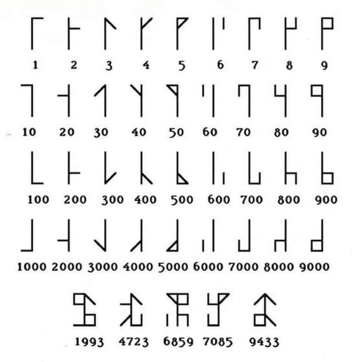

# Cistercian Glyph

A small web app that converts decimal numbers into [Cistercian numerals](https://en.wikipedia.org/wiki/Cistercian_numerals) and renders them as clean SVG geometry. Enter a number, preview the glyph live, and copy it to the clipboard as a transparent PNG.



## Features

- **Live preview** — type a number and see the glyph update instantly
- **Range 0–9999** — four-digit Cistercian encoding (thousands, hundreds, tens, ones)
- **Copy as PNG** — overlay button on the preview exports a 320×320 transparent square; brief checkmark, then resets after 1 second
- **Error toasts** — validation and copy failures stack in the bottom-right (2s auto-dismiss, top progress bar, pause on hover, dismiss button)
- **Dark mode** — sun/moon toggle; preference stored in `localStorage` and applied before first paint
- **Stem-centric geometry** — digits built from reflected segments on a 2×3 grid (see [docs/glyph-system.md](docs/glyph-system.md))

## Quick start

Requires [Node.js](https://nodejs.org/) (LTS recommended).

```bash
npm install
npm run dev
```

Open the URL shown in the terminal (typically `http://localhost:5173`).

### Scripts

| Command | Description |
|---------|-------------|
| `npm run dev` | Start dev server |
| `npm run build` | Type-check and build for production |
| `npm run preview` | Serve the production build locally |
| `npm run lint` | Run ESLint |
| `npm run format` | Format with Prettier |
| `npm run format:check` | Check formatting without writing |

## How it works

Cistercian numerals encode up to four digits in one symbol. A vertical **stem** runs through the center; digit marks attach in four quadrants:

| Quadrant | Place value |
|----------|-------------|
| Upper-left | Tens |
| Upper-right | Ones |
| Lower-left | Thousands |
| Lower-right | Hundreds |

For `1234`: `1` thousands, `2` hundreds, `3` tens, `4` ones. Zero digits leave that quadrant empty.

The glyph body is **2:3** (two units wide, three tall) on a **2×3 grid of square cells**. Preview and export use a **1:1 square canvas** with the glyph centered — never stretched.

Coordinate math, segment vocabulary, and reflection rules: [docs/glyph-system.md](docs/glyph-system.md).

## Project structure

Flat layout for a single-screen app — UI in `components/`, state in `hooks/`, rendering logic in `glyph/`.

```
cistercian-glyph/
├── docs/
│   └── glyph-system.md
├── glyph-reference.png
├── src/
│   ├── assets/icons/          # copy, check, dismiss, sun, moon (.svg)
│   ├── components/
│   │   ├── CistercianGlyph.tsx
│   │   ├── ErrorToasts.tsx    # provider + toast UI
│   │   ├── GlyphPreview.tsx   # preview + copy overlay
│   │   ├── Header.tsx         # title + theme toggle
│   │   ├── Icon.tsx           # renders SVG assets (?raw) with currentColor
│   │   └── NumberInput.tsx
│   ├── glyph/
│   │   ├── cistercian.ts      # paths, transforms, public API
│   │   └── glyphGeometry.ts   # grid, viewBox, MAX_GLYPH_VALUE, SVG_SIZE
│   ├── hooks/
│   │   ├── useCopyGlyph.ts
│   │   ├── useDarkMode.ts
│   │   └── useGlyphInput.ts
│   ├── utils/
│   │   └── svgToPng.ts        # SVG → transparent PNG blob
│   ├── errorToast.ts          # context + useErrorToast
│   ├── App.tsx
│   ├── App.css
│   └── main.tsx
└── index.html
```

## Tech stack

- [React 19](https://react.dev/) with the React Compiler
- [TypeScript](https://www.typescriptlang.org/)
- [Vite 8](https://vite.dev/)
- [Tailwind CSS 4](https://tailwindcss.com/)
